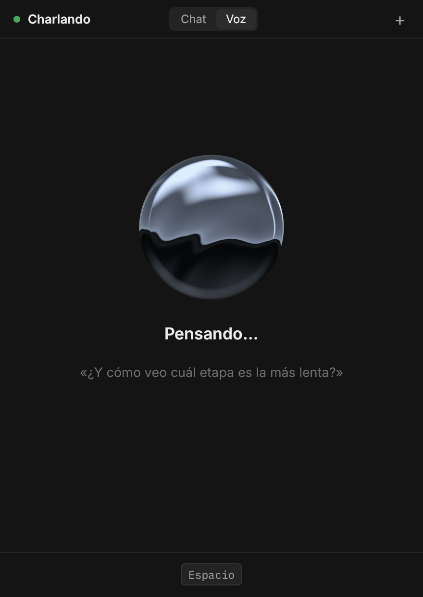
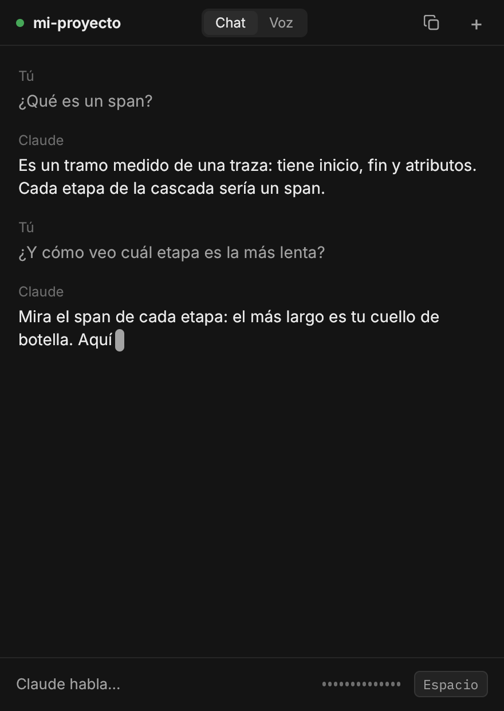

# Charlando

Habla con Claude por voz. Mantienes Espacio, hablas, sueltas, y Claude te responde en voz alta.

Es una cascada de voz: **ASR → LLM → TTS**. Un modelo local, [LFM3-Audio-2B](https://huggingface.co/LiquidAI/LFM3-Audio-2B), pasa tu voz a texto y lee las respuestas. Claude responde a través del [Agent SDK](https://code.claude.com/docs/en/agent-sdk/overview), con tu sesión de Claude Code.

<p align="center">
  
  
</p>

## Cómo funciona

| Pieza | Qué hace | Tecnología |
|---|---|---|
| `app/` | Graba el micrófono, reproduce la voz y muestra la conversación | Rust, [Rune](https://github.com/anomalyco/rune), cpal |
| `servidor/` | Transcribe, llama a Claude y sintetiza la respuesta frase a frase | Python, Transformers, Agent SDK |
| `despliegue/` | El comando `charlando` y el servicio de systemd del servidor | Bash, systemd |

Claude puede leer y buscar archivos en una carpeta de trabajo (`CHARLANDO_CARPETA`, por defecto `/tmp/charlando`) y buscar en la web. Mientras usa una herramienta dice «Déjame mirarlo». No carga tu CLAUDE.md, tus ajustes ni tus memorias, y tampoco guarda memorias.

La app y el servidor se hablan por un WebSocket. El contrato está en [PROTOCOLO.md](PROTOCOLO.md), y el diseño de la interfaz en [diseno/](diseno/).

El servidor y la app pueden estar en máquinas distintas. Por ejemplo, el servidor en un equipo con GPU y la app en un portátil, unidos por una red privada como Tailscale.

Medido con una RTX 3050 de 6 GB y Claude Haiku: la voz de Claude empieza a sonar entre 2,5 y 5 s después de que sueltas Espacio.

## Requisitos

**Servidor:**
- Linux con una GPU NVIDIA y unos 4 GB de VRAM libres.
- [uv](https://docs.astral.sh/uv/).
- [Claude Code](https://code.claude.com) instalado y con sesión iniciada (`claude`).

**App:**
- Linux con Wayland o X11. Probada en Arch con Hyprland.
- Rust y las cabeceras de ALSA (`libasound2-dev` en Debian y Ubuntu, `alsa-lib` en Arch). En Arch con PipeWire también hace falta `pipewire-alsa`.

> Usar tu suscripción de Claude con el Agent SDK está pensado para uso personal. Si construyes un producto para otros, usa una clave de API.

## Instalación

### Servidor

```sh
git clone https://github.com/ruben-salas20/charlando
cd charlando/servidor
cp .env.example .env        # ajusta CHARLANDO_HOST si la app está en otra máquina
uv sync
mkdir -p ~/.config/systemd/user
sed "s|RUTA_DEL_REPO|$(dirname "$PWD")|" ../despliegue/charlando.service > ~/.config/systemd/user/charlando.service
systemctl --user daemon-reload
```

La primera vez que hables, el servidor descarga el modelo de Hugging Face (unos 4 GB).

### App

```sh
cd charlando/app
cargo build --release
install -Dm755 target/release/charlando ~/.local/lib/charlando/charlando-app
install -Dm755 ../despliegue/charlando ~/.local/bin/charlando
mkdir -p ~/.config/charlando
cp ../despliegue/charlando.env.example ~/.config/charlando/charlando.env
```

Si el servidor está en otra máquina, edita `~/.config/charlando/charlando.env`: pon en `CHARLANDO_SSH` el host de ssh y en `CHARLANDO_URL` su dirección.

## Uso

| Comando | Qué hace |
|---|---|
| `charlando` | Arranca el servidor, abre la app y, al cerrarla, apaga el servidor |
| `charlando servidor iniciar` | Arranca el servidor |
| `charlando servidor parar` | Apaga el servidor y libera la GPU |
| `charlando servidor reiniciar` | Reinicia el servidor |
| `charlando servidor estado` | Dice si está en marcha y cuánta GPU se usa |
| `charlando servidor registros` | Muestra los registros en vivo |

En la app:
1. Elige el modelo (Haiku, Sonnet u Opus) y si Claude puede razonar antes de responder.
2. Pulsa «Empezar».
3. Mantén **Espacio** mientras hablas y suéltalo al terminar.

El servidor carga el modelo al empezar y lo descarga tras 3 minutos sin uso (`CHARLANDO_INACTIVIDAD`).

## Configuración

El servidor lee `servidor/.env`. Todas las variables están explicadas en [servidor/.env.example](servidor/.env.example).

| Variable | Por defecto | Para qué |
|---|---|---|
| `CHARLANDO_HOST` | `127.0.0.1` | IP donde escucha el servidor |
| `CHARLANDO_PORT` | `8765` | Puerto |
| `CHARLANDO_MODELO` | `LiquidAI/LFM3-Audio-2B` | Id de Hugging Face o carpeta local |
| `CHARLANDO_INACTIVIDAD` | `180` | Segundos sin uso antes de descargar el modelo |
| `CHARLANDO_CARPETA` | `/tmp/charlando` | Única carpeta donde Claude puede leer y buscar archivos |
| `CHARLANDO_LIBERAR_GPU_URL` | vacía | URL que libera la GPU de otro servidor de modelos, como llama-swap |

## Licencia

MIT. Las fuentes Inter e IBM Plex Mono de `app/assets/` tienen su propia licencia (OFL), junto a cada fuente. El modelo LFM3-Audio-2B se distribuye con la [LFM Open License v1.0](https://huggingface.co/LiquidAI/LICENSE) y no se incluye en este repo.
